# Hospital
医疗信息管理系统（ssm+layui+freemaker）
## docker 创建mysql schema
docker run --name mysql -e MYSQL_ROOT_PASSWORD=123456 -d -i -p 3306:3306 mysql:latest
MYSQL_ROOT_PASSWORD=123456 意味着账号是root，密码是123456
## 执行sql文件 
Hospital/sql/hospital.sql
## 关于gen.xml
Hospital/src/main/java/com/hospital/uitls/MybatisGen.java 这个类执行可以生成初始化的mybatis的xml
## 系统截图

以下截图采集于 2026-11-02，来自当前代码启动后的真实系统。使用隔离 H2 内存数据库和合成演示资料，不连接生产数据库或真实支付；浏览器页面截图不捕获鼠标指针。

### 首页与登录
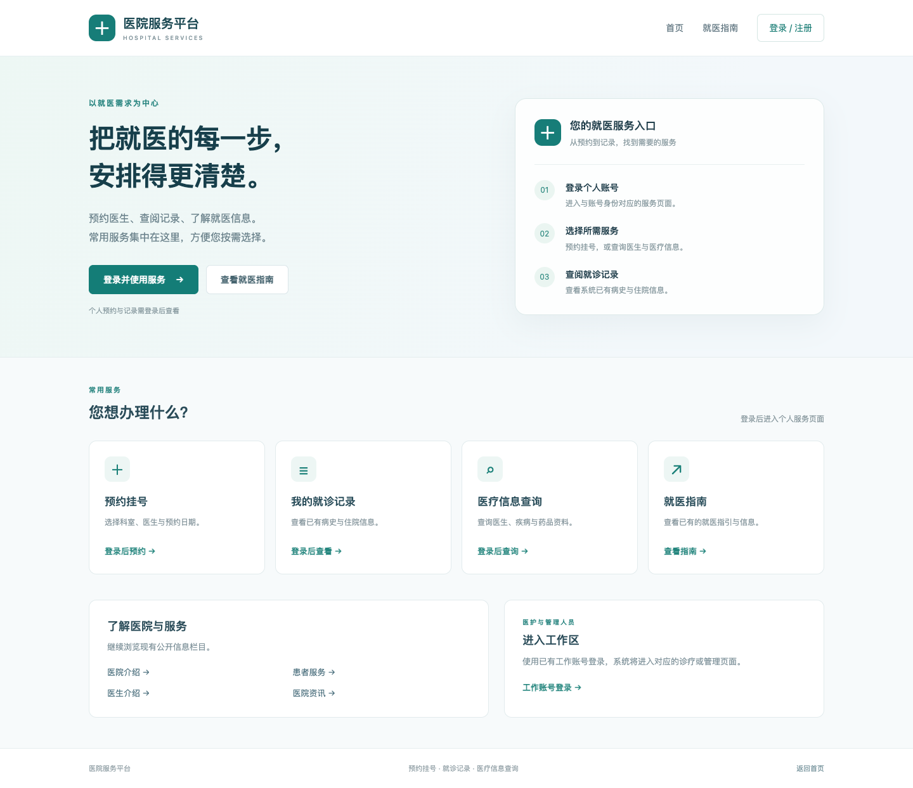
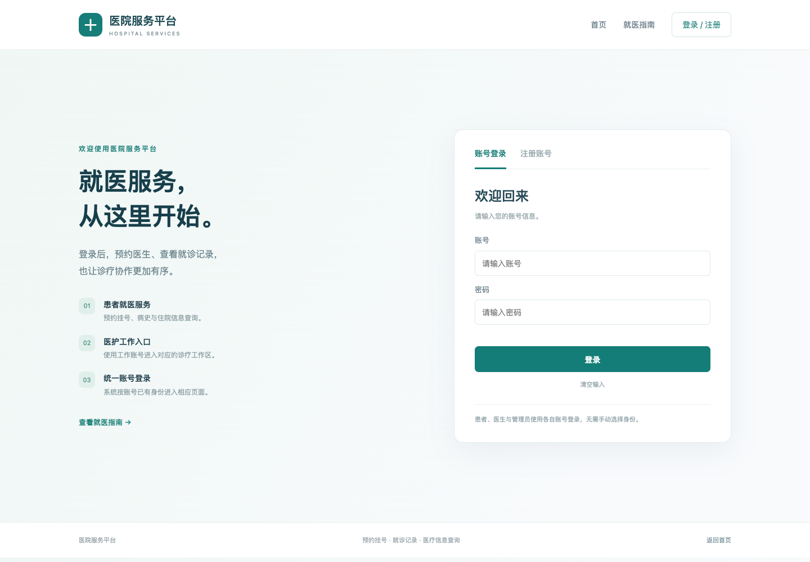

### 患者服务
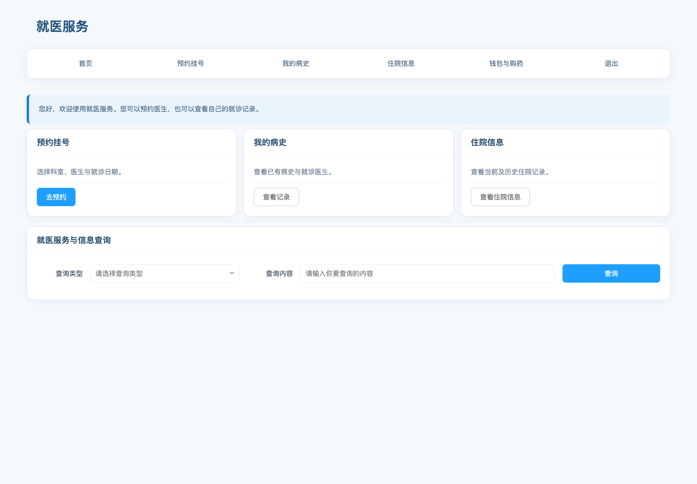
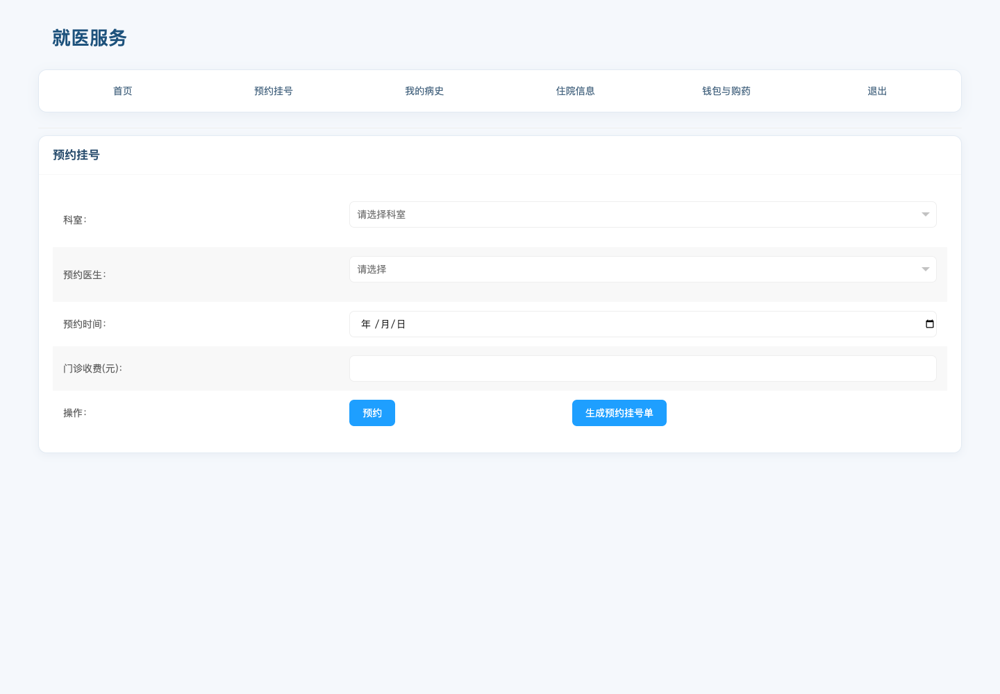
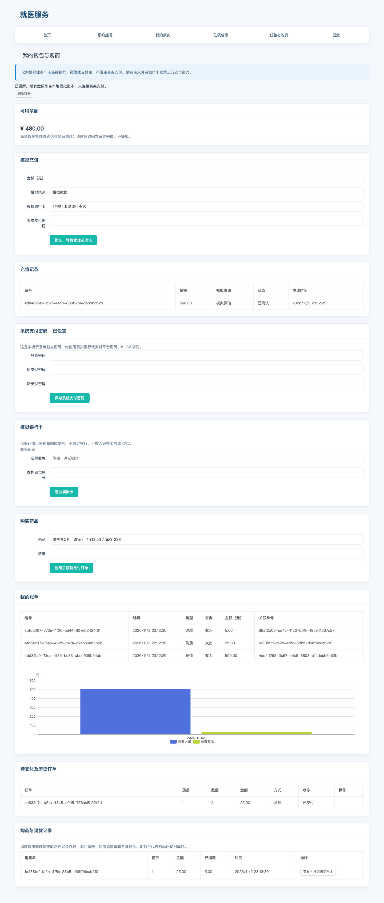

### 医生工作台
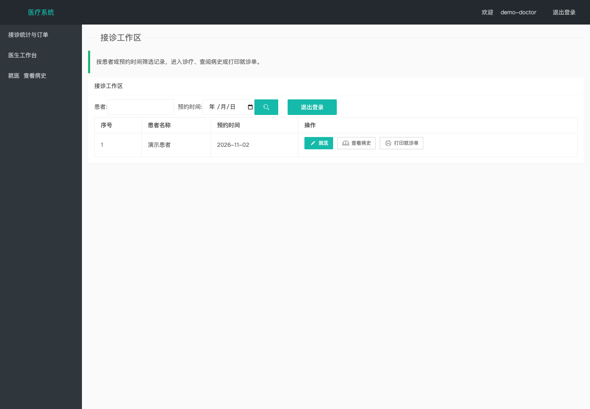
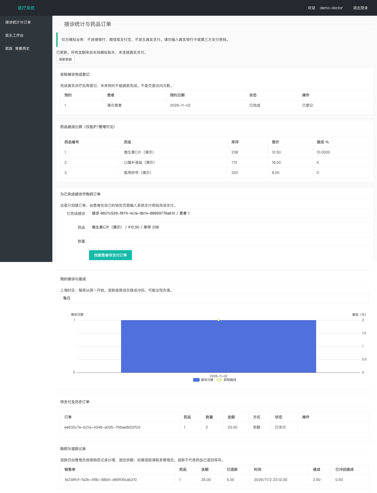

### 管理员工作台
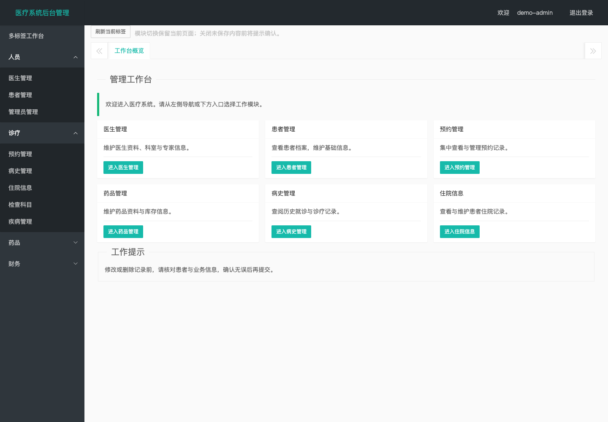
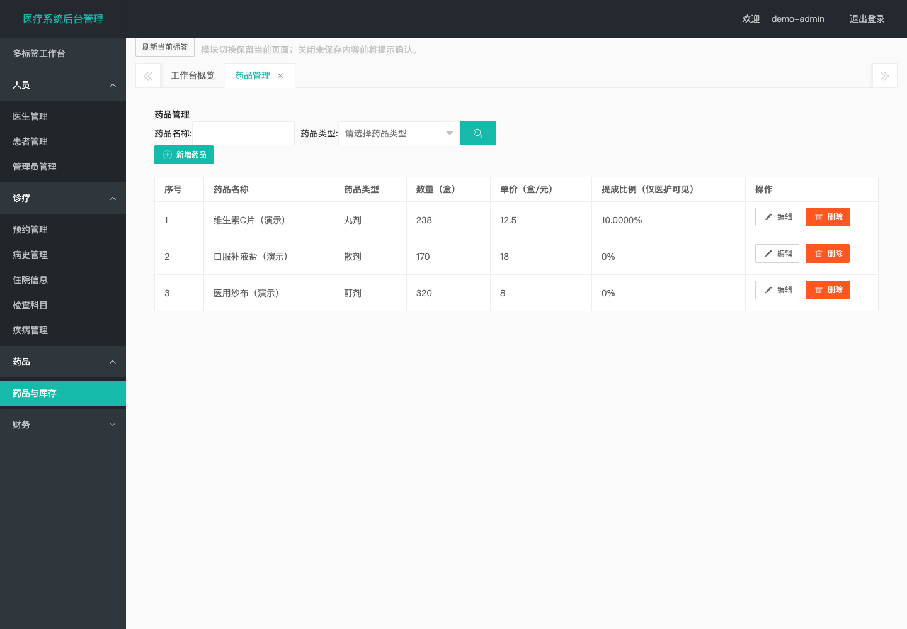
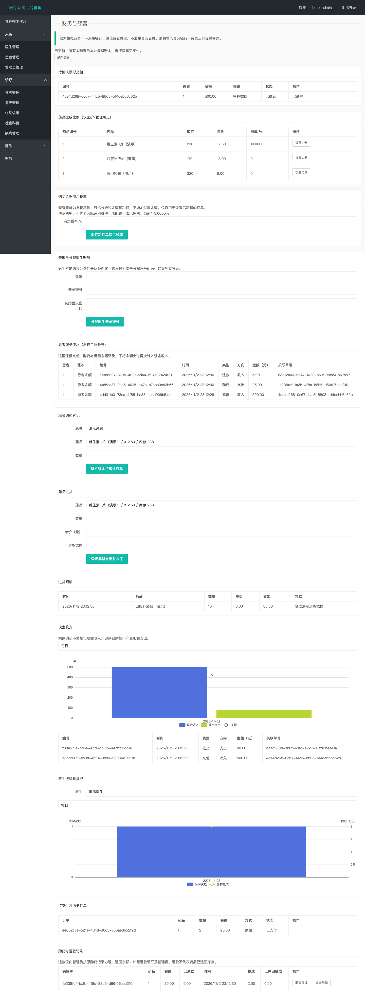
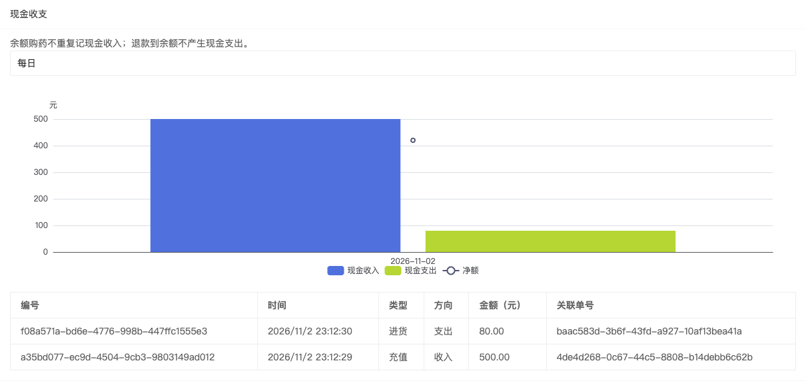
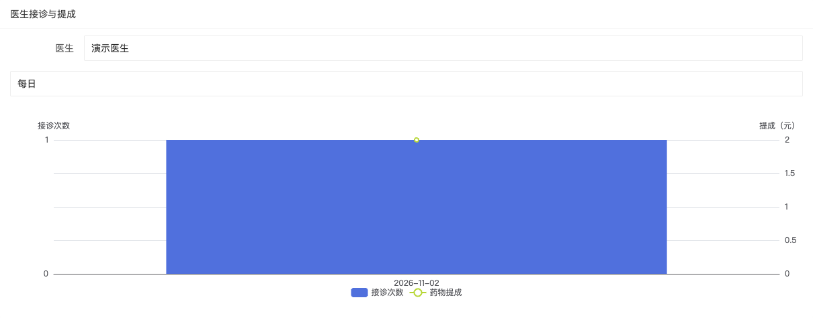

本次回归结果与验证边界见 [合并前验证记录](docs/merge-validation-2026-11-02.md)。
